# Plots: compatibility-2026-11-07

Input: `/mnt/s/Projects/tvcache-rust/results/compatibility-2026-11-07`

Paper panels use unmatched real workloads. Local replay estimates are not measured training speedups.

## rust-snapshots-off/capacity/hit_rate

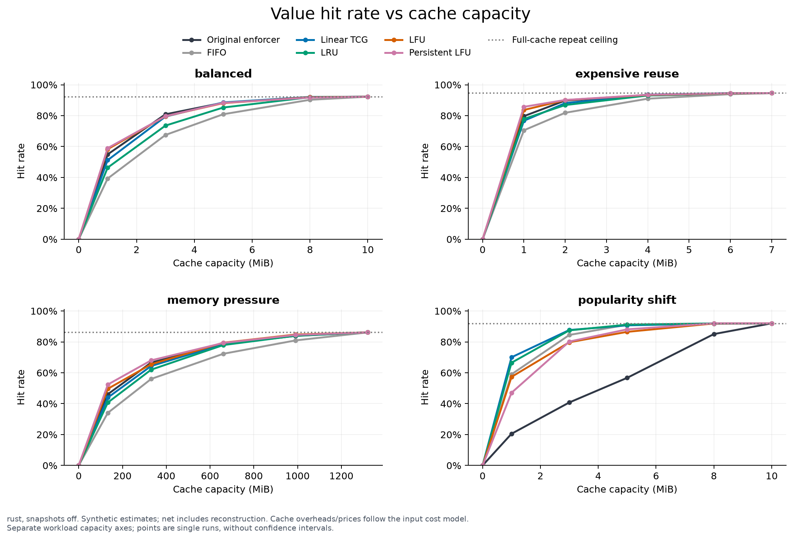

rust, snapshots off. Synthetic estimates; net includes reconstruction. Cache overheads/prices follow the input cost model.
Separate workload capacity axes; points are single runs, without confidence intervals.

[PDF](rust-snapshots-off/capacity/hit_rate.pdf) · [Data](rust-snapshots-off/capacity/hit_rate.csv) · [Provenance](rust-snapshots-off/capacity/hit_rate.json)

## rust-snapshots-off/capacity/time_saved

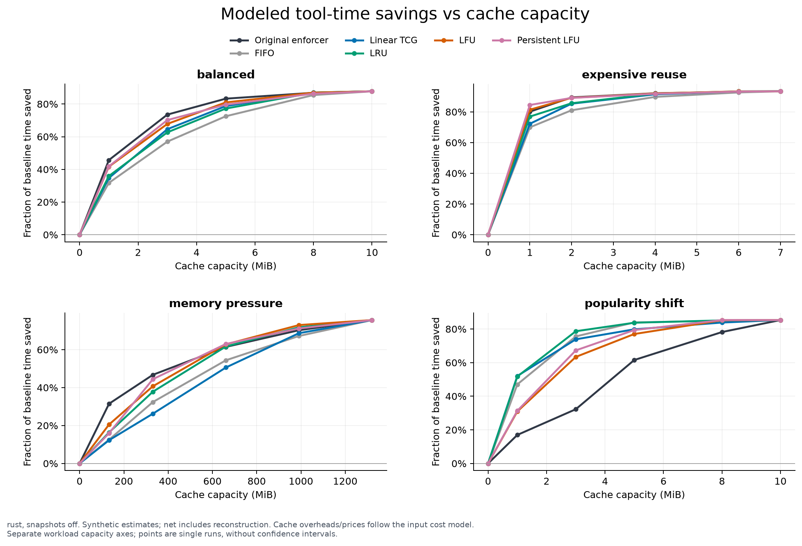

rust, snapshots off. Synthetic estimates; net includes reconstruction. Cache overheads/prices follow the input cost model.
Separate workload capacity axes; points are single runs, without confidence intervals.

[PDF](rust-snapshots-off/capacity/time_saved.pdf) · [Data](rust-snapshots-off/capacity/time_saved.csv) · [Provenance](rust-snapshots-off/capacity/time_saved.json)

## rust-snapshots-off/capacity/cost_saved

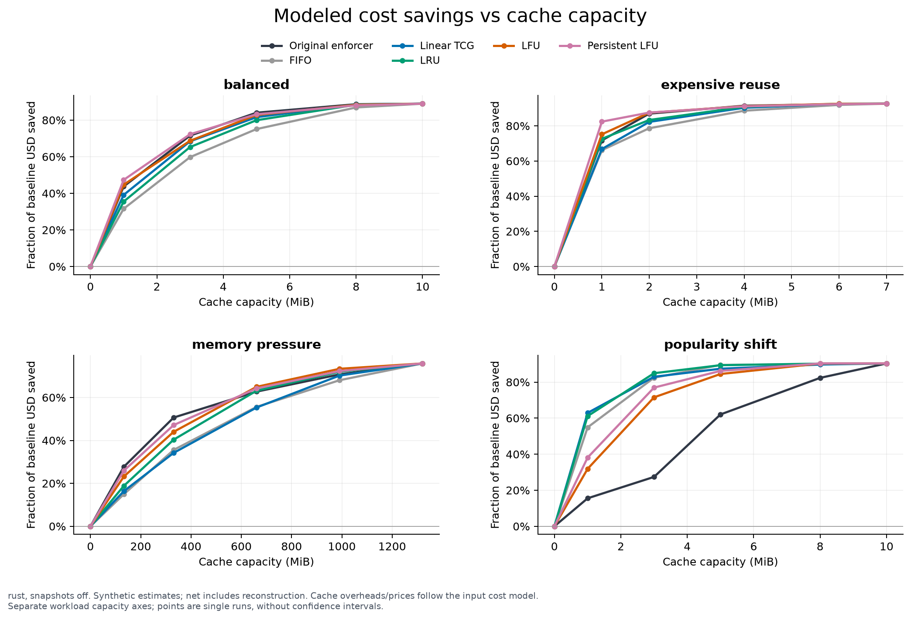

rust, snapshots off. Synthetic estimates; net includes reconstruction. Cache overheads/prices follow the input cost model.
Separate workload capacity axes; points are single runs, without confidence intervals.

[PDF](rust-snapshots-off/capacity/cost_saved.pdf) · [Data](rust-snapshots-off/capacity/cost_saved.csv) · [Provenance](rust-snapshots-off/capacity/cost_saved.json)

## rust-snapshots-off/tradeoffs/vs_original

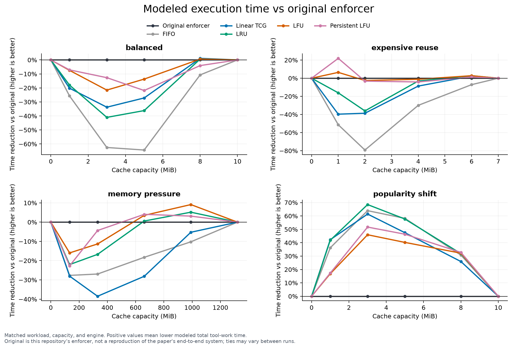

Matched workload, capacity, and engine. Positive values mean lower modeled total tool-work time.
Original is this repository's enforcer, not a reproduction of the paper's end-to-end system; ties may vary between runs.

[PDF](rust-snapshots-off/tradeoffs/vs_original.pdf) · [Data](rust-snapshots-off/tradeoffs/vs_original.csv) · [Provenance](rust-snapshots-off/tradeoffs/vs_original.json)

## rust-snapshots-off/tradeoffs/policy_overhead

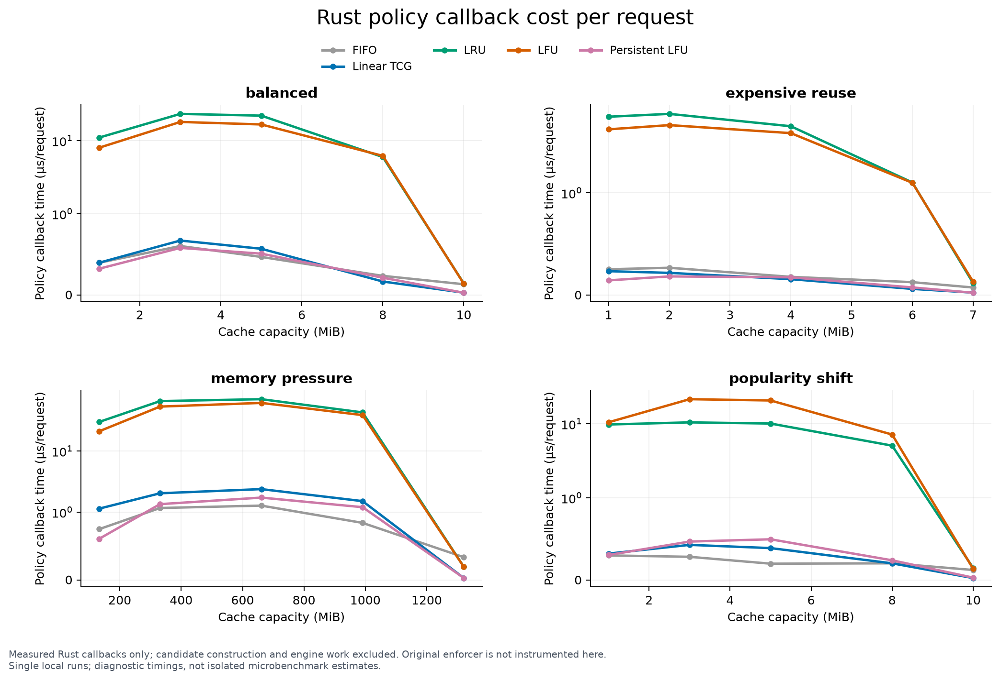

Measured Rust callbacks only; candidate construction and engine work excluded. Original enforcer is not instrumented here.
Single local runs; diagnostic timings, not isolated microbenchmark estimates.

[PDF](rust-snapshots-off/tradeoffs/policy_overhead.pdf) · [Data](rust-snapshots-off/tradeoffs/policy_overhead.csv) · [Provenance](rust-snapshots-off/tradeoffs/policy_overhead.json)

## rust-snapshots-off/reconstruction/gross_vs_net

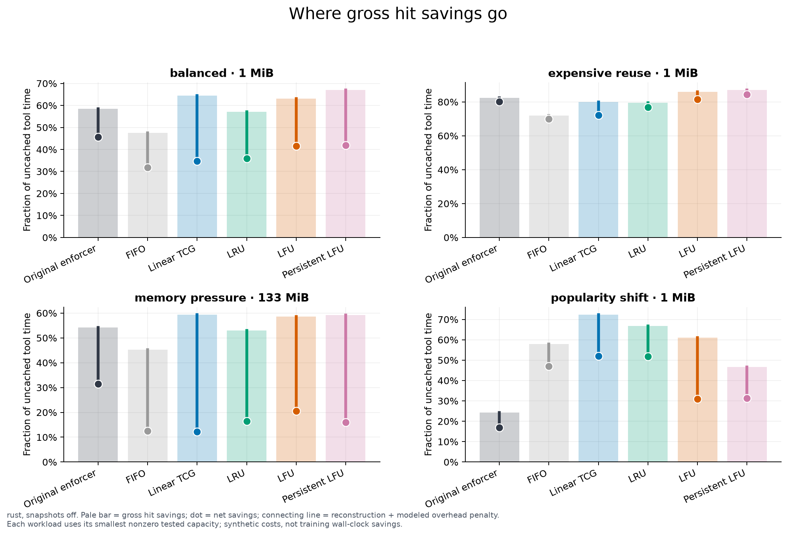

rust, snapshots off. Pale bar = gross hit savings; dot = net savings; connecting line = reconstruction + modeled overhead penalty.
Each workload uses its smallest nonzero tested capacity; synthetic costs, not training wall-clock savings.

[PDF](rust-snapshots-off/reconstruction/gross_vs_net.pdf) · [Data](rust-snapshots-off/reconstruction/gross_vs_net.csv) · [Provenance](rust-snapshots-off/reconstruction/gross_vs_net.json)

## rust-snapshots-off/snapshots/net_benefit

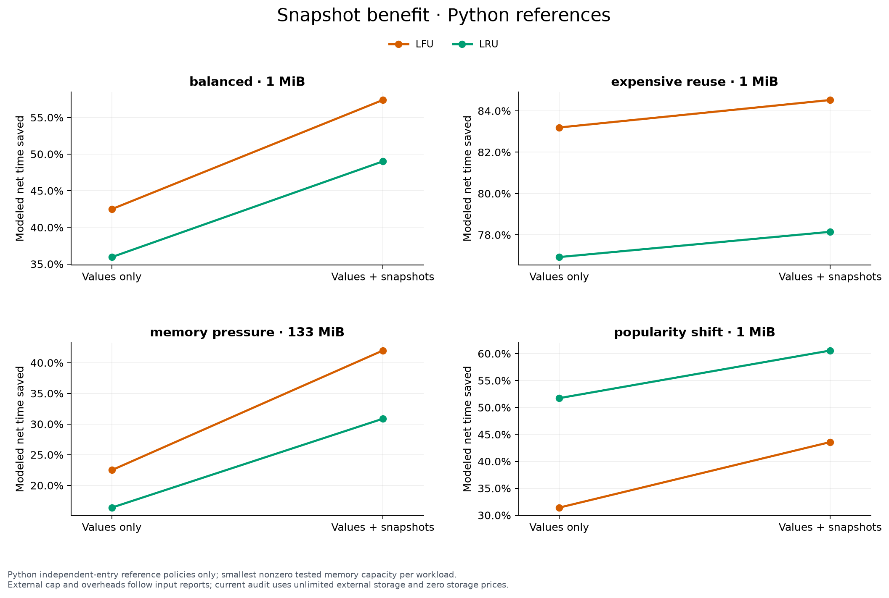

Python independent-entry reference policies only; smallest nonzero tested memory capacity per workload.
External cap and overheads follow input reports; current audit uses unlimited external storage and zero storage prices.

[PDF](rust-snapshots-off/snapshots/net_benefit.pdf) · [Data](rust-snapshots-off/snapshots/net_benefit.csv) · [Provenance](rust-snapshots-off/snapshots/net_benefit.json)

## rust-snapshots-off/snapshots/external_storage

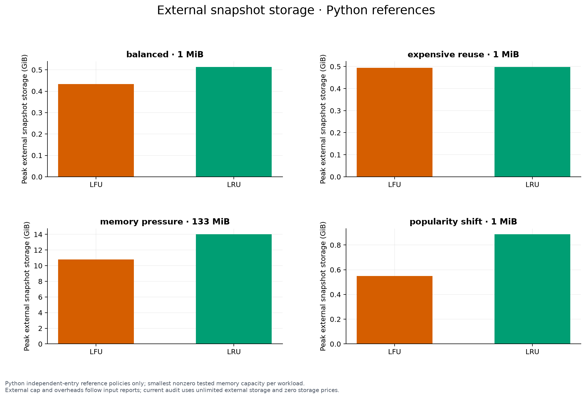

Python independent-entry reference policies only; smallest nonzero tested memory capacity per workload.
External cap and overheads follow input reports; current audit uses unlimited external storage and zero storage prices.

[PDF](rust-snapshots-off/snapshots/external_storage.pdf) · [Data](rust-snapshots-off/snapshots/external_storage.csv) · [Provenance](rust-snapshots-off/snapshots/external_storage.json)

## rust-snapshots-off/scaling/local_load

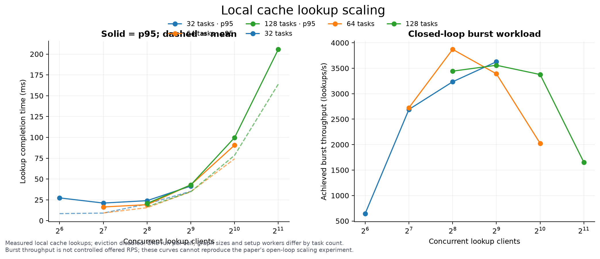

Measured local cache lookups; eviction disabled. One run per cell; graph sizes and setup workers differ by task count.
Burst throughput is not controlled offered RPS; these curves cannot reproduce the paper's open-loop scaling experiment.

[PDF](rust-snapshots-off/scaling/local_load.pdf) · [Data](rust-snapshots-off/scaling/local_load.csv) · [Provenance](rust-snapshots-off/scaling/local_load.json)

## rust-snapshots-off/paper/hit_rate_context

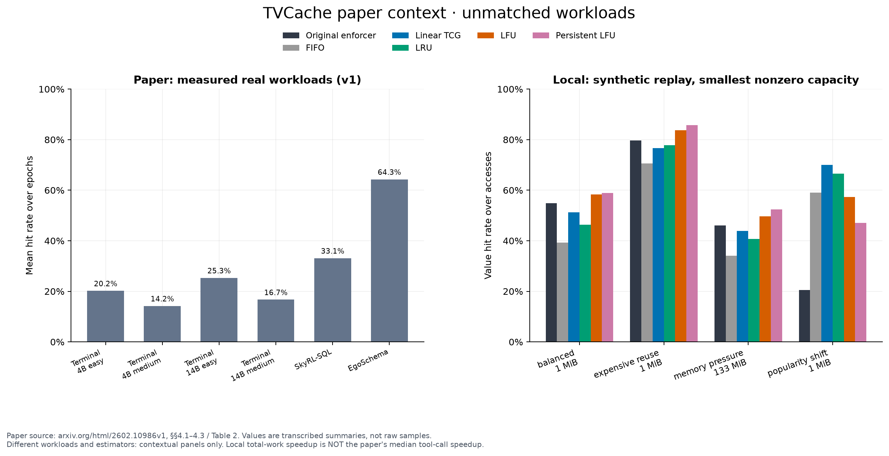

Paper source: arxiv.org/html/2602.10986v1, §§4.1–4.3 / Table 2. Values are transcribed summaries, not raw samples.
Different workloads and estimators: contextual panels only. Local total-work speedup is NOT the paper's median tool-call speedup.

[PDF](rust-snapshots-off/paper/hit_rate_context.pdf) · [Data](rust-snapshots-off/paper/hit_rate_context.csv) · [Provenance](rust-snapshots-off/paper/hit_rate_context.json)

## rust-snapshots-off/paper/speedup_context

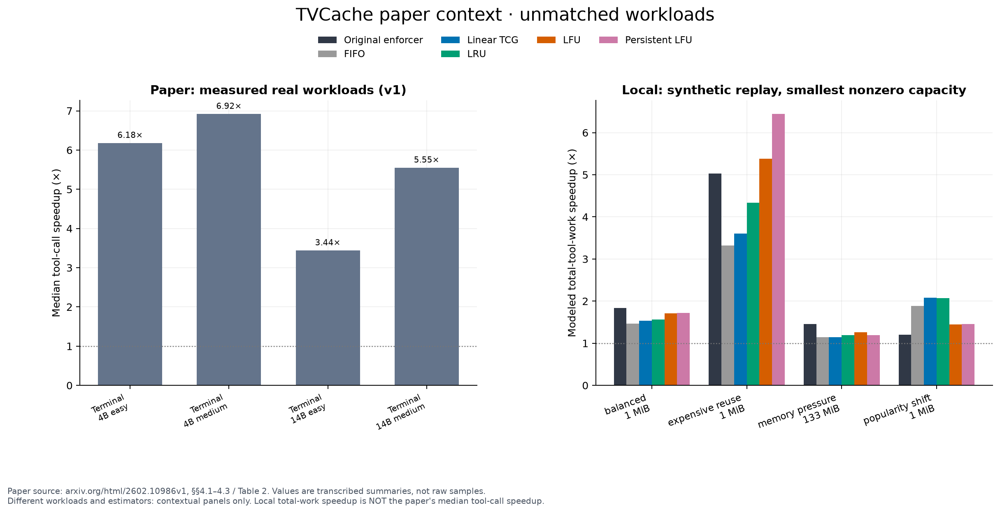

Paper source: arxiv.org/html/2602.10986v1, §§4.1–4.3 / Table 2. Values are transcribed summaries, not raw samples.
Different workloads and estimators: contextual panels only. Local total-work speedup is NOT the paper's median tool-call speedup.

[PDF](rust-snapshots-off/paper/speedup_context.pdf) · [Data](rust-snapshots-off/paper/speedup_context.csv) · [Provenance](rust-snapshots-off/paper/speedup_context.json)
